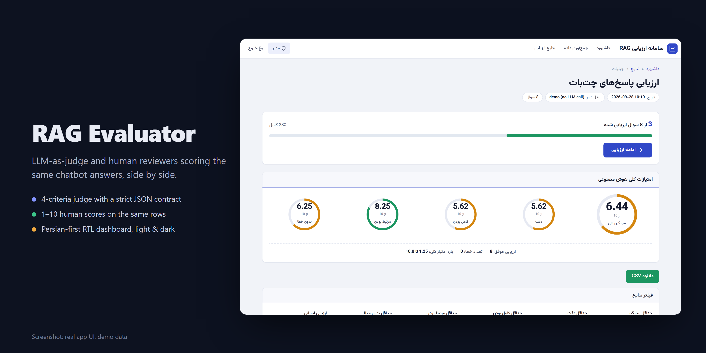
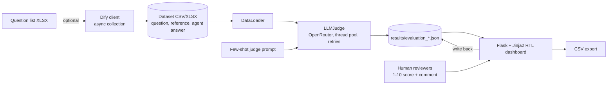
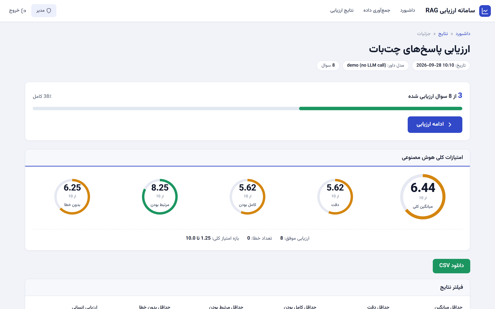
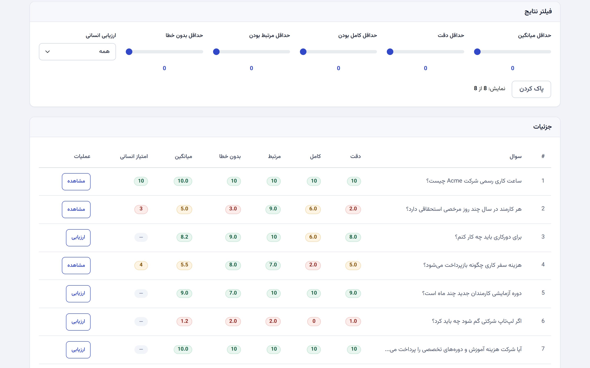
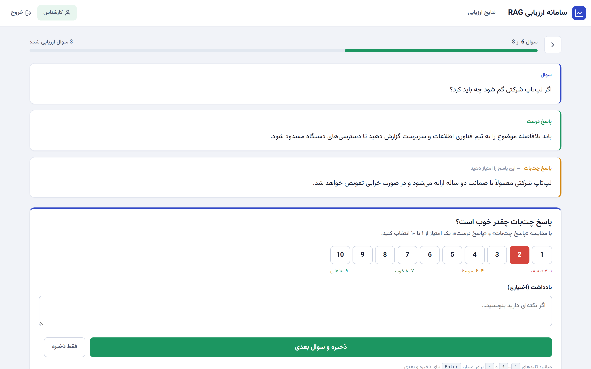
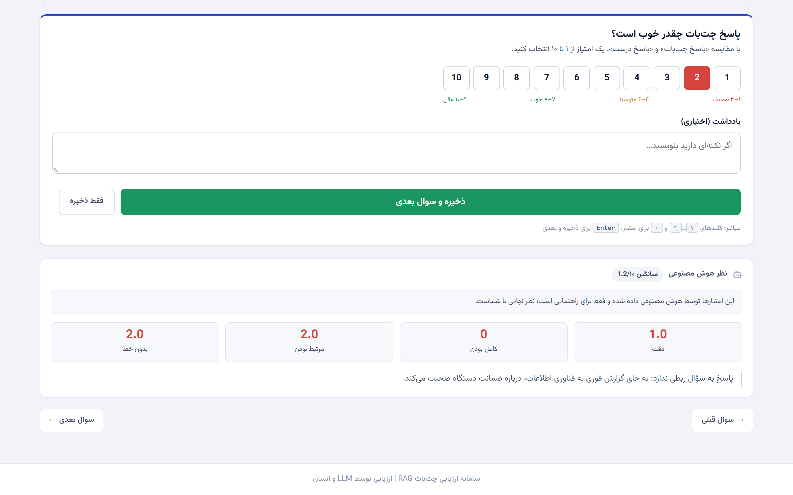
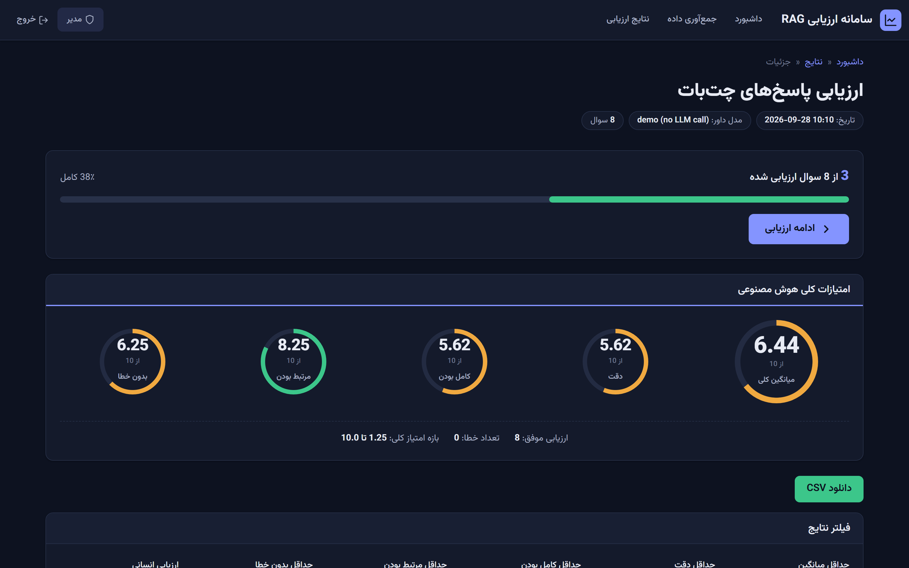
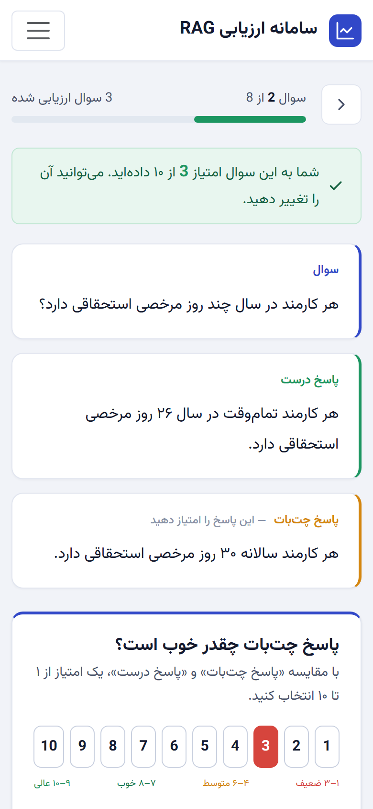

# RAG Evaluator



**Find out where your RAG chatbot is wrong: an LLM judge scores every answer on four criteria, and human experts score the same answers side by side.**


## Highlights

- **LLM-as-judge, 4 criteria** (accuracy, completeness, relevance, faithfulness) with a few-shot prompt and a strict JSON contract.
- **Human-in-the-loop scoring** on the same rows, with AI scores hidden by default to reduce anchoring, and keyboard shortcuts for fast review.
- **Robust batch runs**: thread-pool judging, tenacity retries, errored rows flagged instead of silently scored zero.
- **Optional answer collection from a Dify chatbot**: async, bounded concurrency, partial saves.
- **Persian-first RTL UI** with light and dark themes and a mobile-friendly scoring page.

## Why it's interesting

- **Judge and humans on the same rows.** Every question gets four LLM scores plus a 1-10 human score and comment stored in the same result file, so you can see where the judge and people disagree.
- **Few-shot judge prompt with a fixed JSON contract** (`evaluator/prompts.py`), and a tolerant parser (`_parse_response` in `evaluator/llm_judge.py`) that strips code fences and extracts the JSON object even when the explanation is long Persian text. Unparseable rows are flagged `error` and excluded from aggregates instead of silently counted as zero.
- **Robust batch execution.** Thread-pool judging with tenacity retries, error messages with suggestions, per-file locks for concurrent human-score writes, and an mtime-invalidated results cache.
- **Answer collection from a Dify chatbot** (`evaluator/dify_client.py`): async, semaphore-bounded, with backpressure after consecutive failures, incremental partial saves and a retry pass. Optional; you can also bring your own answers in a CSV.
- Persian-first: Persian column names, RTL Bootstrap, Vazirmatn font, few-shot examples in Persian.

## Architecture



The Flask app (`app.py`) runs judging and collection as background threads with pollable progress endpoints. Results live as JSON files; human scores are written back into the same file.

## Evaluation methodology

Each row is `(question, ground-truth answer, agent response)`. The judge sees all three and returns JSON with four 0-10 scores and a short explanation.

| Criterion | Question the judge answers |
|---|---|
| Accuracy | Is the response factually consistent with the ground truth? |
| Completeness | Does it cover the key points of the ground truth? |
| Relevance | Does it address the question that was asked? |
| Faithfulness | Is it free of invented details not supported by the ground truth? |

- **Judge prompt:** `evaluator/prompts.py` - role description, three graded few-shot examples (excellent, good, poor), the criteria definitions above, then the row to score. Temperature 0.1 by default.
- **Aggregates:** per-criterion mean/min/max plus an overall mean, computed over non-errored rows.
- **Human-in-the-loop:** reviewers open a row, see question, reference and agent answer first (AI scores are collapsed to reduce anchoring), pick 1-10, optionally comment, and move to the next unscored row. Experts and admins have separate roles.
- **Known limitation:** low reasoning effort with a small token budget can truncate the judge's JSON; raise `JUDGE_MAX_TOKENS` or disable reasoning (`JUDGE_REASONING_EFFORT=off`) if you see errored rows.

## Tech stack

Python, Flask (+ Flask-WTF CSRF, Flask-Compress), pandas/openpyxl, requests + tenacity, aiohttp, OpenRouter (any model), Jinja2 + Bootstrap 5 RTL.

## Getting started

```bash
python -m venv venv && source venv/bin/activate   # Windows: venv\Scripts\activate
pip install -r requirements.txt
cp .env.example .env    # set SECRET_KEY, ADMIN_PASSWORD, EXPERT_PASSWORD, OPENROUTER_API_KEY
python app.py           # http://127.0.0.1:5000
```

A synthetic demo dataset ships in `uploads/sample_qa.csv` (8 questions about a fictional "Acme" employee handbook, with some deliberately wrong or evasive agent answers). Log in as admin, start an evaluation on it, then score rows as an expert.

**No API key?** `results/evaluation_demo.json` is a pre-judged result for that dataset. It was produced by `python scripts/seed_demo_results.py`, which runs the real judge pipeline (prompt building, JSON parsing, aggregation) but swaps the OpenRouter call for canned, fictional judgments. The judge model shows as `demo (no LLM call)`. Start the app and open it from the Results page.

Dataset format: CSV (UTF-8) or XLSX with columns `سوال`, `جواب مرجع`, `Agent Response`.

To collect answers from a Dify app instead, set `DIFY_API_URL` and `DIFY_API_KEY` and use the Collect page. `test_dify_connection.py` is a connectivity and load-test script for that endpoint.

## Tests

There is no automated test suite. `python test_dify_connection.py` checks the optional Dify connection.

## Screenshots

All screenshots show the real app with demo data (synthetic dataset plus fictional judge outputs, no LLM call).

| | |
|---|---|
|  |  |
| **Results dashboard**: aggregate score per criterion and human-review progress | **Results table**: judge scores next to the human score, with filters |
|  |  |
| **Expert scoring**: question, reference, then the bot answer, with a 1-10 score | **Judge opinion**: the AI scores and explanation, collapsed until the expert opens them |
|  |  |
| **Dark theme** follows the OS setting | **Mobile**: the scoring flow works on a phone |

To regenerate them: seed the demo file, run the app with `SECRET_KEY=dev ADMIN_PASSWORD=admin EXPERT_PASSWORD=expert FLASK_PORT=4170 python app.py`, then `node scripts/capture-screenshots.js` (needs Playwright installed where Node can resolve it). The same script renders `docs/images/hero.png` from `scripts/hero.html`.

## License

MIT
